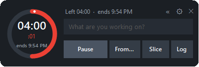
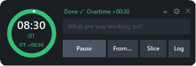
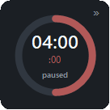
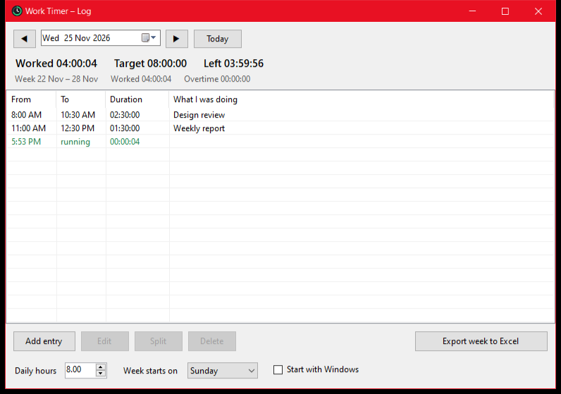

# Work Timer

A tiny always-on-top work timer for Windows. It counts your **8-hour day**, tells you **when your shift ends**, tracks **overtime**, lets you **slice the day into described tasks**, and exports a **weekly Excel sheet**.

One small EXE (~60 KB). No installer, no account, no internet needed (except the optional auto-update). Works offline.

| Working (red until your hours are done) | Overtime (green) | Collapsed |
|---|---|---|
|  |  |  |



## Download

1. Go to the **[latest release](../../releases/latest)** and download **`WorkTimer.exe`**.
2. Put it anywhere you like (Desktop, Documents…) and double-click it.
3. Press **Start** when you begin work. That's it.

> **Windows SmartScreen** may say "Windows protected your PC" because the file is new and unsigned.
> Click **More info → Run anyway**. The full source is in this repo and the EXE is built from it by GitHub Actions.

Requires Windows 10/11 (uses the .NET Framework 4.8 that is already part of Windows).

## What it does

- **Timer ring** – fills as you work towards your daily hours. **Red** until you've done your hours, **green** once you are in overtime.
- **Shift end time** – always shows *when you'll finish* if you keep working (e.g. `ends 9:54 PM`).
- **Overtime** – counted automatically past your daily target (`OT +00:30`), per day and per week.
- **Pause / Resume** – lunch, calls, whatever. Paused time is never counted. Hotkey: **Ctrl + Alt + P**.
- **Start from a chosen time** – forgot to start? Click **From…** and say you started at 4:30 PM.
- **Slice** – switching task? Click **Slice**: the previous block is saved with its description and exact from–to times.
- **Log** – edit, add, split or delete any entry for any day.
- **Weekly Excel export** – one click gives an `.xlsx` with a per-day summary (worked, overtime, short-by) and every entry.
- **Always visible, never in the way** – drag it anywhere, set its **transparency**, collapse it to just the ring (double-click it, or the **«** button), or hide it to the tray.
- **Safe** – sleep/shutdown pauses the timer; a crash never loses more than ~20 seconds; work running past midnight is split into two days correctly.
- 12-hour clock (AM/PM) everywhere. Daily hours and week start day are configurable.

## Tips

| Do this | To get this |
|---|---|
| Click the tray icon | show / hide the timer |
| Right-click the timer | menu: pause, collapse, transparency, always-on-top |
| Click the ⚙ on the timer | transparency slider |
| `Ctrl + Alt + P` | pause / resume from any app |
| Double-click the ring | collapse / expand |
| Tray menu → *Exit* | quit (the ✕ only hides the window) |

By default it also **starts with Windows** (turn it off in the Log window or tray menu).

## Automatic updates

Work Timer checks this repository's **[Releases](../../releases)** about 30 seconds after it starts, then every 6 hours. When a newer version exists it:

1. downloads `WorkTimer.exe` over HTTPS,
2. verifies the **SHA-256 checksum** published with the release and that the version number matches,
3. replaces itself and restarts. If your timer was running, it keeps running.

Turn it off any time: tray icon → right-click → untick **Update automatically**. *Check for updates now* is there too.
If the EXE sits in a read-only folder it can't replace itself – it will tell you, and you can download the new one manually.

The only network traffic is a request to `api.github.com` / `github.com` for the latest release. No telemetry, no data about you is sent anywhere.

### How releases happen
Every push to `main` is built and tested by [GitHub Actions](.github/workflows/release.yml). If all tests pass, a new release `v1.0.<run number>` is published automatically with `WorkTimer.exe` and `WorkTimer.exe.sha256`, and every installed copy picks it up. So: *change the code → push → everyone is updated.*

## Your data

Everything stays on your PC in `%APPDATA%\WorkTimer\` as plain text:

| File | Contents |
|---|---|
| `entries.tsv` | your time entries (start, end, description) – open it in Excel or Notepad |
| `settings.ini` | daily hours, week start, transparency, window position… |
| `error.log` | only appears if something went wrong |

Back it up by copying that folder.

## Build from source

Needs only Windows (the C# compiler ships with it):

```powershell
git clone https://github.com/ahmed-abokhatwa/Timer.git
cd Timer
powershell -ExecutionPolicy Bypass -File build.ps1      # creates WorkTimer.exe next to the script
```

Run the test suite (it drives the real code; needs Python with `openpyxl` for the Excel check):

```powershell
pip install openpyxl
powershell -STA -ExecutionPolicy Bypass -File tests\test.ps1 -Exe .\WorkTimer.exe -Work $env:TEMP
```

The app is a single C# file: [`WorkTimer.cs`](WorkTimer.cs). Set `WORKTIMER_DATA=<folder>` to use a separate data folder and `WORKTIMER_NO_UPDATE=1` to disable update checks (handy for testing).

## License

[MIT](LICENSE) – free to use, change and share.
